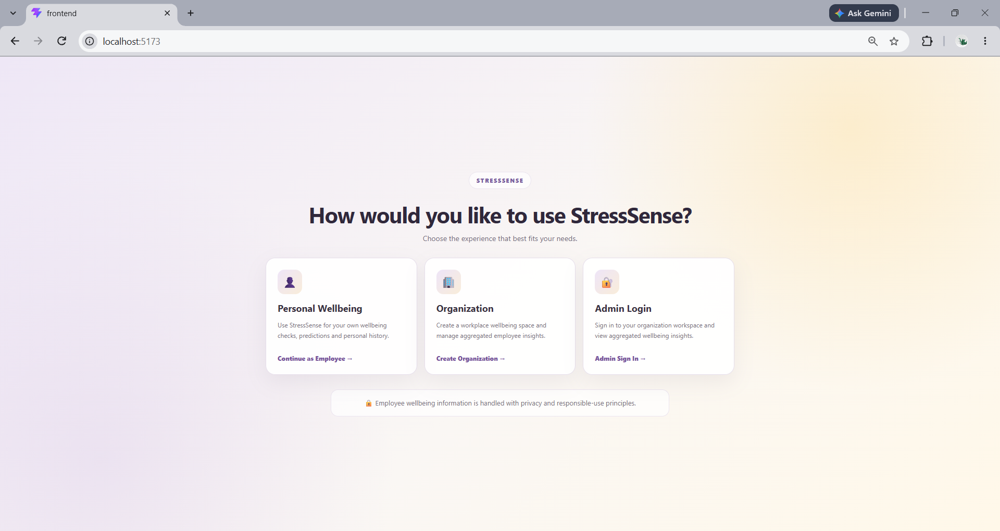
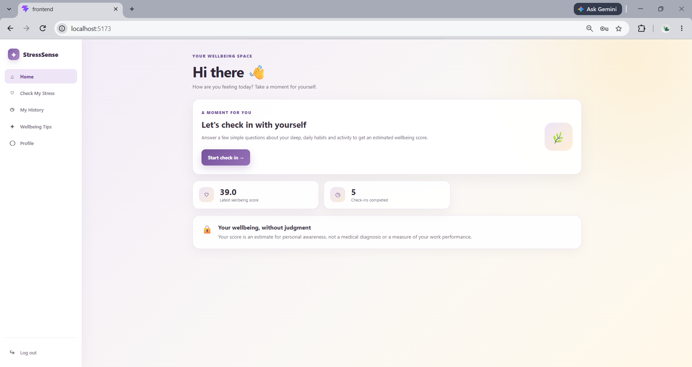
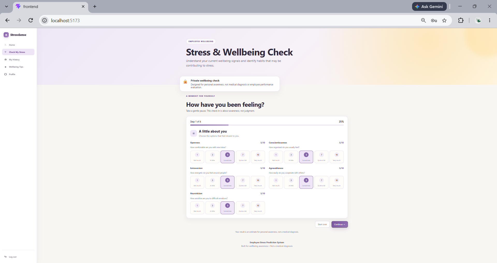
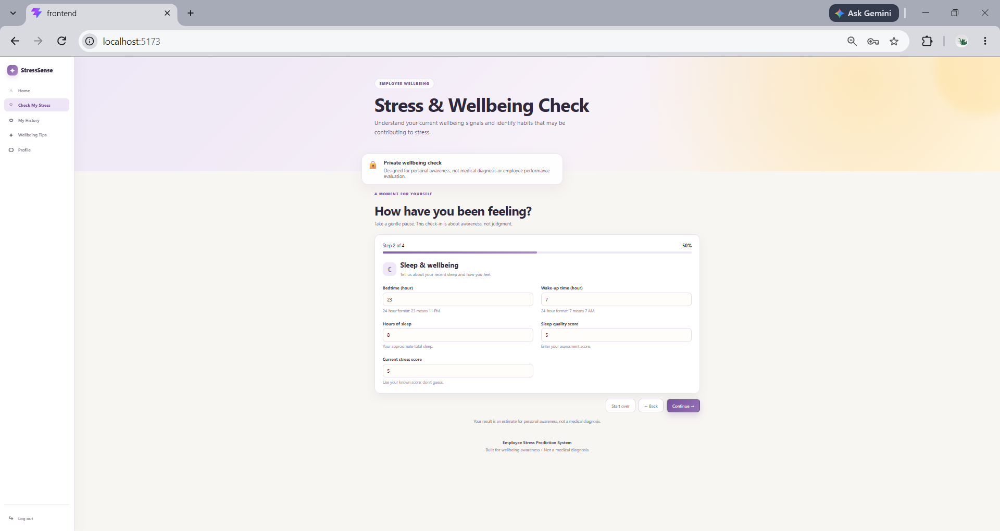
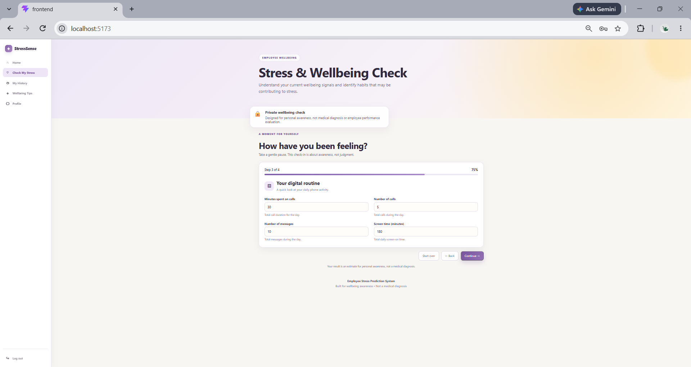
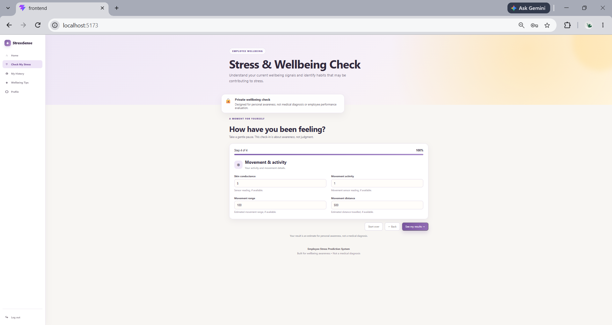
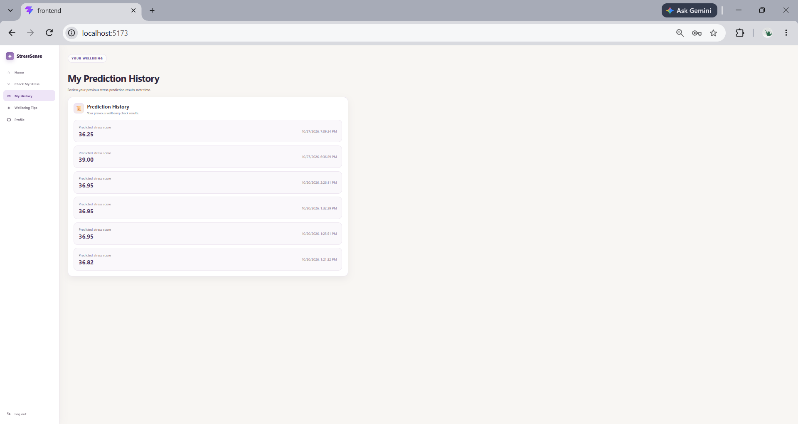
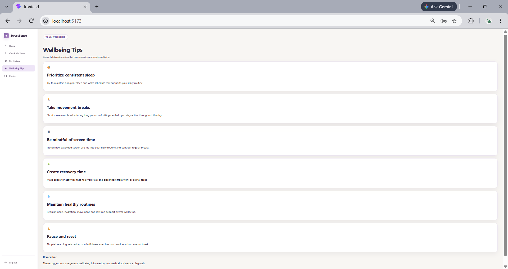
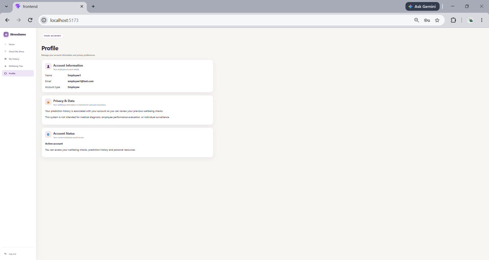

# StressSense — Employee Stress & Wellbeing Prediction System

StressSense is a web-based application that predicts employee stress levels using machine learning and provides personal wellbeing insights. It also offers organization-level aggregated insights to support workplace wellbeing.

## Features

- **Stress Prediction:** Estimate stress levels from user-provided information.
- **Employee Dashboard:** View wellbeing scores and completed check-ins.
- **Wellbeing Check-in:** Answer questions about habits and personal wellbeing.
- **Prediction History:** Review previous prediction results.
- **Wellbeing Tips:** Explore suggestions for healthier daily habits.
- **Employee Profile:** View account information and privacy details.
- **Admin Dashboard:** View aggregated organization-level wellbeing statistics.
- **Privacy-Aware Insights:** Keep individual employee prediction results out of the organization overview.

## Tech Stack

| Component | Technology |
|---|---|
| Frontend | React.js, Vite, CSS |
| Backend API | Node.js, Express.js |
| Machine Learning API | Python, FastAPI |
| Machine Learning Model | Random Forest |
| Database | PostgreSQL with Prisma ORM |
| Authentication | JWT and bcrypt |

## Machine Learning

StressSense uses a **Random Forest** model to estimate stress levels from input features.

**Reported accuracy: 90%** — this figure should be included only if it has been verified against the model's actual evaluation results.

## Application Screenshots

### 1. Employee Dashboard


### 2. Stress & Wellbeing Check


### 3. Wellbeing Questionnaire


### 4. Prediction History


### 5. Wellbeing Tips


### 6. Employee Profile


### 7. Admin Dashboard


### 8. Organization Wellbeing Overview


### 9. Stress Score Analytics


### 10. Wellbeing Patterns and Insights


## Running Locally

### 1. Start the frontend

```bash
cd frontend
npm install
npm run dev
```

### 2. Start the Node.js backend

Open another terminal:

```bash
cd backend
npm install
node server.js
```

### 3. Start the machine learning API

Open another terminal from the project root:

```powershell
cd ml-service
.\venv\Scripts\Activate.ps1
python -m uvicorn main:app --reload --port 8000
```

The commands assume the Python virtual environment already exists and the required dependencies are installed.

## Local URLs

- Frontend: http://localhost:5173
- Node.js Backend: http://localhost:5000
- FastAPI Documentation: http://127.0.0.1:8000/docs

## Privacy Disclaimer

StressSense is designed for personal awareness and aggregated workplace wellbeing insights. It is not intended to diagnose medical conditions or evaluate individual employee performance.

## Author

**Daniya Qazi**

GitHub: [DaniyaQazi](https://github.com/DaniyaQazi)
